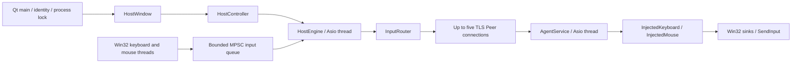

# Architecture and protocol

`SPEC.md` remains the product specification. The repository root is the monorepo
root (no additional `sharekeys/` directory is required).

## Ownership and threads

- `sharekeys_core` contains portable event types, injected-key/button ownership,
  wire codec, routing and grid layout. Router/injection objects are single-thread
  confined; fake sinks permit deterministic tests without desktop side effects.
- Windows `KeyboardHook` and `MouseHook` own dedicated message-loop threads and
  low-level hooks. Hook callbacks filter all injected input, update physical state,
  detect shortcuts before forwarding, and enqueue fixed-size records. No socket
  operations, disk writes or GUI calls run in these callbacks. One bounded MPSC
  queue connects both hooks to the host networking thread, preserving publication
  order between keyboard and mouse events. The queue never waits for space.
- `HostEngine` owns one Asio event-loop thread, TLS context, router and up to five
  device slots. Each connection has its own bounded outbound queue. GUI commands
  are posted to this thread. The GUI reads a mutex-protected status snapshot;
  hooks use atomic suppression/emergency state and never acquire this mutex.
- `HostController` (`src/gui/host_controller.cpp`) bridges HostEngine to Qt: a
  100 ms Qt timer emits `statusChanged` snapshots; command methods delegate to
  HostEngine. Device slots remain in the engine, saved device records in the
  existing HostWindow configuration layer.
- Qt widgets and rendering stay on the main GUI thread. Input hooks are destroyed
  before the engine. Engine shutdown requests releases, closes sockets (which
  also triggers agent cleanup), stops its event loop and joins its thread.
- The agent setup window owns an `AgentService` for each listener session. Its
  TLS accept/read loop and keyboard/mouse injection run on a dedicated Asio
  thread; a Qt timer reads a mutex-protected status snapshot every 200 ms. Stop closes
  the listener, disconnects the peer, requests release and joins that thread.
  Agent settings are saved atomically in the per-user application-data folder;
  optional login startup uses a per-user Windows Run key. Host settings persist
  paired devices and optional reconnect, but routing starts in Local mode.
- Agent network handling and input injection are confined to its Asio thread.
  Separate hooks observe physical state. A 100 ms recovery timer retries failed
  releases while disconnected; no new session is admitted until cleanup succeeds.

The input queue has 2048 slots. Producers reserve slots atomically; a consumer
cannot overtake an earlier unfinished publication. Allocation and locks are absent
from push. After eight failed reservation attempts, capture fails safely to Local
rather than spinning indefinitely on a hook thread. This establishes a shared
publication order; actual hardware scheduling and inter-PC execution times are
not synchronized.

## Authentication and pairing

Each interactive user generates a self-signed P-256 identity through OpenSSL.
Windows encrypts private-key PEM using user-scoped DPAPI; only the protected blob
is written. Linux development identities are mode-0600 PEM files. Creation refuses
to overwrite existing identities. Partial identity creation fails closed.

Pairing explicitly authorizes the peer's SHA-256 leaf-certificate fingerprint on
both PCs. Fingerprints must be exchanged through a trusted channel. TLS 1.3 proves
possession of the pinned private key; a CA certificate or hostname is not the
trust anchor. Exact pins, certificate validity times and mutual certificate
presentation are required. No automatic trust-on-first-use is implemented.
PAIR_REQUEST and PAIR_APPROVED are reserved wire types; pairing is currently a
local administrative/configuration operation, and these types are rejected on
an established input session. Revocation is performed from the agent setup UI
after stopping its listener.

The agent sends HELLO with a cryptographically random, nonzero 64-bit session ID
after TLS authentication. The client sends AUTHENTICATE bound to that session;
the server confirms AUTHENTICATE before application commands are admitted. Every
direction starts at sequence 1. Commands before confirmation, stale session IDs,
duplicates and gaps close the connection. Reconnect creates a fresh session and
forces Local mode. Identity storage, pin lists and the logged-in account are
part of the trust boundary; a compromised same-user process is out of scope.

## Binary format (version 1)

All multibyte integers are big endian, written field-by-field. No C++ object memory
is serialized. A frame is a four-byte unsigned body length, followed by:

| Field | Bytes | Meaning |
| --- | ---: | --- |
| Version | 2 | 1 |
| Type | 2 | HELLO=1 through ERROR=16; see `protocol.hpp` |
| Session | 8 | Nonzero server-generated session |
| Sequence | 8 | Strictly increasing, per direction |
| Payload | 0–4076 | Validated by message type |

Minimum body size is 20; maximum is 4096. Asio reads the prefix and bounded body
exactly, including partial TCP reads. A timeout applies even to incomplete bodies.

- KEY_DOWN/KEY_UP: scan code (u16), virtual key (u16), extended flag (u8).
- MOUSE_MOVE: absolute flag (u8), X and Y (i32, two's-complement). Relative deltas
  are limited to ±32767; absolute coordinates are normalized 0–65535 over the
  combined virtual desktop.
- MOUSE_BUTTON: button index (u8, left/right/middle/X1/X2), down flag (u8).
- MOUSE_WHEEL: vertical and horizontal deltas (i32 each), limited to ±32767.
- HEARTBEAT: empty or a request/response flag (u8) followed by a nonce (u64).
  Nonce-matched replies provide protocol RTT, never application latency/acceptance.
- DEVICE_STATUS: up to 256 bytes; cursor edge report is `{1, edge}`, where edges
  are none=0, left=1, right=2, top=3, bottom=4. Cursor reports are sent every 100 ms.
- ERROR: up to 256 bytes, reserved diagnostics. Other types have no payload.

Per-peer output is capped at 1024 messages and input at 2000 messages per second.
Overflow/rate errors close that session. The agent also limits TLS/application
handshakes to 5 seconds; heartbeats occur every second with a 3-second inactivity
threshold. Reconnect backs off from 250 ms to 30 seconds. IPv4 private/link-local
and loopback destinations are allowed; public addresses and wildcard agent binds
are refused. Network topology/firewall policy still determines physical LAN reach.

## Input correctness

Injected key/button state records only accepted down events. Repeated downs are
preserved. Unknown ups are ignored. Release failures remain tracked for retry.
Observed physical holds suppress synthetic releases so local agent users' keys
are not deliberately released. Physical ownership before hook startup cannot be
identified reliably, and Windows merges physical/injected logical key state.

Every mode/target change releases the old recipients. Held inputs are quarantined
until their up events, so an old modifier is not transferred into another target.
Exclusive local suppression follows each key/button's original down decision,
including its eventual up, even across mode changes. Emergency commands use an
atomic path independent of queue capacity; the pipeline returns to Local and
drains stale queued commands without forwarding them. Capture records carry an
emergency epoch so delayed producer publication cannot re-enable an old command;
hook-side quarantine also blocks repeats of keys held across emergency recovery.
Mouse mirroring is separate
and disabled on startup. Edge transitions use grid adjacency, center both cursors
and wait 750 ms before accepting another transition.

Identical keyboard layouts are required. SendInput success means only that Windows
accepted an input record. Neither it nor a network reply proves that a trading
application (or any other application) executed a business action.

## Desktop startup to shutdown (current revision)

1. `apps/host/main.cpp:16` constructs QApplication, installs application resources,
   chooses the per-user ShareKeysHost directory and takes its QLockFile. It creates
   the identity only when absent, then constructs HostEngine and HostWindow.
   `initializeDesktopApplication` sets the icon/version and Fusion style.
2. `HostEngine::HostEngine` loads TLS identity and starts its private Asio thread.
   HostWindow loads devices/groups/layout/settings and optionally requests saved
   connections. Input begins Local. Its HostController posts commands through the
   engine API and emits snapshot signals to the widgets; it owns no transport.
3. On Windows, main constructs KeyboardHook and MouseHook bound to engine capture
   callbacks. These own independent Win32 message loops. In smoke mode they are
   skipped. Main then shows the GUI (or an explicitly requested background tray)
   and runs QApplication's event loop. Startup exceptions show an error dialog;
   smoke errors return a failing exit code without a modal dialog.
4. The remote `apps/agent/gui_main.cpp:16` establishes its identity/process lock,
   constructs physical-state hooks and Win32 sinks, then supplies AgentWindow a
   factory for AgentService. Save/start validates the host pin and bind address;
   AgentService accepts mutually authenticated TLS and dispatches input to sinks.
5. Default Host close calls emergencyStop and exits. Optional close-to-tray still
   requests Local; minimizing preserves routing. Qt shutdown destroys hooks before
   HostEngine, so no callback accesses a destroyed engine. The engine requests
   releases and closes sockets, stops io_context and joins. Closing immediately
   means queued release frames are not guaranteed to flush; the agent's socket
   close/heartbeat recovery releases independently. This path has a fake-sink TLS
   regression test, not a native Windows success claim.
6. Agent default close/explicit Quit destroys AgentService before its sinks/hooks.
   The service closes the peer/listener, releases injected keys/buttons, joins,
   and retries releases during teardown. If the user explicitly chose continued
   operation in the tray, closing only hides the agent. No software cleanup can
   run after that agent process is forcibly terminated.

The Qt UI library is `sharekeys_desktop_ui`; core/network remain Qt independent.
`desktop.json` stores close/minimize preferences separately from host.json and
agent authorization, preserving legacy formats. No old identity folders are
renamed. In-memory diagnostic history contains mode/connection transitions only.
It is bounded and exported only at the user's request.

`HostEngine::setMode/controlDevice` bind GUI activation commands to the emergency
input epoch. An emergency invalidates already queued activations as well as
captured input. `enterRemote` checks the epoch after cursor centering too.
`HostEngine::fail` is the worker exception boundary: it restores local suppression,
closes peers, stops the event loop and publishes a restart-required unhealthy
snapshot. It does not silently restart input. Agent timeout remains an independent
recovery mechanism when the host cannot deliver a release frame.
